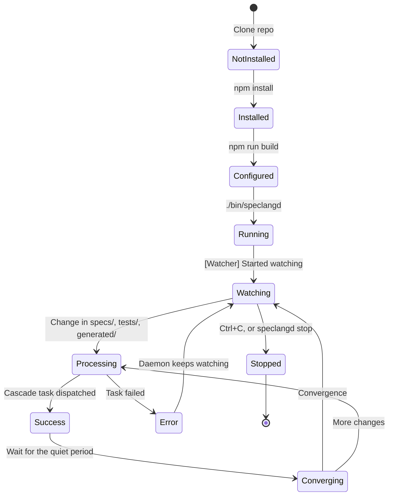

# speclang-header lines:8
id: "@speclang/roadmap/poc/user-flows"
parent: "@ref:specs/roadmap/poc"
version: 0.1.0
layer: 2
short: "User interaction flows and journeys"
tags: [poc, ux, user-flows, interactions]
---

# POC: User Interaction Flows

Complete user journey and interaction flows for the shipped SpecLang daemon.

## Which binary this page documents

The runnable daemon is **`bin/speclangd`** — the reactive watcher CLI that ships in this
repository. Every transcript below was captured from `bin/speclangd` itself at commit
a0688b19, in a throw-away directory, with the command shown beside it. A line of output
appears here only if that binary printed it; nothing is illustrative.

Three entry points look similar and are not interchangeable:

| Entry point | What it is |
|---|---|
| `bin/speclangd` | The shipped daemon CLI: `start`, `stop`, `status`, `pause`, `resume`, `abort`, `trigger <file>`, `converge` |
| `bin/speclangd-poc` | The legacy POC entry point, kept for the POC design record. This is the one that accepts `--watch <dir>` |
| `bin/speclang` | The umbrella CLI (`speclang start`, `speclang status`, and the spec/cascade commands) |

Operational detail — ports, the dashboard, pid files, the status matrix across the three
status commands, and known failure modes — belongs to `docs/OPERATIONS.md`. This page is the
guided tour of what a user does and sees.

## Primary User Flow

### @poc/flows/primary

**The Happy Path: Create → Edit → Watch → Use**

```
┌─────────────────────────────────────────────────────────────┐
│  1. USER INSTALLS AND BUILDS SPECLANG                       │
│     $ git clone <repo> && npm install && npm run build      │
│     The daemon loads dist/. Unbuilt, it exits 1 with:       │
│       "SpecLang not built. Run: npm run build"              │
└─────────────────────────────────────────────────────────────┘
                            │
                            ▼
┌─────────────────────────────────────────────────────────────┐
│  2. USER STARTS DAEMON                                      │
│     $ ./bin/speclangd                                       │
│     [Watcher] Started watching: specs/, tests/, generated/  │
│     [CLI] Running in foreground. Press Ctrl+C to stop.      │
└─────────────────────────────────────────────────────────────┘
                            │
                            ▼
┌─────────────────────────────────────────────────────────────┐
│  3. USER CREATES SPEC                                       │
│     $ mkdir -p specs                                        │
│     $ vim specs/feature.spec.md                             │
└─────────────────────────────────────────────────────────────┘
                            │
                            ▼
┌─────────────────────────────────────────────────────────────┐
│  4. WATCHER SEES THE CHANGE                                 │
│     The change is inside a watched root, so the daemon      │
│     dispatches a cascade task for the file.                 │
└─────────────────────────────────────────────────────────────┘
                            │
                            ▼
┌─────────────────────────────────────────────────────────────┐
│  5. CASCADE RUNS                                            │
│     Routed target: specs/<file> becomes generated/<file>    │
│     Agents do the work (docs/OPERATIONS.md, cascade docs).  │
└─────────────────────────────────────────────────────────────┘
                            │
                            ▼
┌─────────────────────────────────────────────────────────────┐
│  6. USER USES THE RESULT                                    │
│     $ ./bin/speclangd status                                │
│     Cascade Depth: 0                                        │
│     $ ls generated/                                         │
└─────────────────────────────────────────────────────────────┘
```

Code generation is the cascade's job and is documented in `docs/OPERATIONS.md` and the
cascade docs. This page deliberately stops at the route: a change under a watched root
becomes a task, and a spec path is routed to its `generated/` counterpart.

## User Personas

### @poc/flows/personas

**Persona 1: New Developer (Alice)**
- Just heard about SpecLang
- Wants to try it quickly
- Needs clear error messages
- Wants to see immediate results

**Goals:**
1. Install and build in < 5 minutes
2. Start the daemon and see it watching in < 2 minutes
3. Understand the workflow intuitively

**Pain Points:**
- Confused by dual-view (specs vs generated/)
- Doesn't know what to edit
- Scared of "generated code"

**Flow for Alice:**
```
1. Reads README
2. Runs quick start commands
3. Starts the daemon, sees the watch roots
4. Creates first spec (copy-paste example)
5. Watches the cascade pick it up
6. Edits spec, sees the route update
7. "Aha!" moment ✨
```

**Persona 2: Experienced Dev (Bob)**
- Understands code generation
- Wants to integrate into existing project
- Needs configuration options
- Cares about performance

**Goals:**
1. Integrate with existing codebase
2. Customize output location
3. Configure for team use
4. CI/CD integration

**Flow for Bob:**
```text
1. Installs as dev dependency
2. Points the daemon at a project directory
3. Integrates into build pipeline
4. Sets up team conventions
5. Writes custom templates (future)
```

## Detailed Interactions

### @poc/flows/interactions

**Scenario 1: First start, in an empty directory**

An empty directory is a supported starting point: the watcher names the three roots it
watches and starts even though none of them exists on disk yet. There is no "watch directory
missing" failure path in `bin/speclangd`.

```bash
$ cd /tmp/my-project          # empty: no specs/, no .speclang/
$ /path/to/SpecLang/bin/speclangd
```

```
🚀 Starting Speclangd (foreground)...
[CLI] Agent dispatch: daemon tasks → cascade coordinator ✅
[Daemon] Starting speclangd...
[Watcher] Started watching: specs/, tests/, generated/
[Daemon] Started successfully
[CLI] Daemon started
[CLI] Running in foreground. Press Ctrl+C to stop.
```

`bin/speclangd` with no argument runs the `start` subcommand in the foreground; the process
blocks until it is signalled.

**Scenario 2: Second start in the same project**

The first start leaves `.speclang/daemon-state.json` behind, and the next start reports that
it loaded it. That is the only line the second start adds:

```bash
$ /path/to/SpecLang/bin/speclangd
```

```
🚀 Starting Speclangd (foreground)...
[CLI] Agent dispatch: daemon tasks → cascade coordinator ✅
[Daemon] Starting speclangd...
[Watcher] Started watching: specs/, tests/, generated/
[State] Loaded state from .speclang/daemon-state.json
[Daemon] Started successfully
[CLI] Daemon started
[CLI] Running in foreground. Press Ctrl+C to stop.
```

**Scenario 3: Background start, status, stop**

`start -d` detaches and returns immediately; `status` reads the pid file and state file
without starting a second daemon; `stop` signals the detached process. PIDs and uptime below
come from one real run.

```bash
$ ./bin/speclangd start -d
```

```
🚀 Speclangd daemon started in background (PID 2968837)
   Log: .speclang/speclangd.log
   PID: .speclang/speclangd.pid
   Check status: speclangd status
```

```bash
$ ./bin/speclangd status
```

```
🟢 Daemon: Running
   PID: 2968837
   Status: idle
   Cascade Depth: 0
   Files Changed: 0
   Active Agents: 0
   Uptime: 3s
```

`status --json` prints the same numbers as JSON:

```bash
$ ./bin/speclangd status --json
```

```
{
  "running": true,
  "pid": 2968837,
  "status": "idle",
  "cascadeDepth": 0,
  "filesChanged": 0,
  "lastEventAt": null,
  "startedAt": 1795739047446,
  "activeAgents": 0
}
```

This is how you actually stop a background daemon:

```bash
$ ./bin/speclangd stop
```

```
✅ Sent SIGTERM to daemon (PID 2968837)
✅ Daemon stopped
```

```bash
$ ./bin/speclangd status
```

```
🔴 Daemon: Stopped
```

After a clean `stop`, `.speclang/` keeps `daemon-state.json`, `daemon.prom` and `locks/`; the
pid file and the background log are removed.

**Scenario 4: Starting a second background daemon**

`start -d` refuses when a live daemon already owns the pid file, and exits 1:

```bash
$ ./bin/speclangd start -d
```

```
❌ Daemon already running (PID 2981582). Run 'speclangd stop' first.
```

A pid file left behind by a crashed process does not block the next start: `status` reports
`🔴 Daemon: Stopped` and leaves the file in place, while `start -d` clears the stale file and
starts a new daemon. Both were probed with a pid file containing `999999`.

**Scenario 5: Stopping a foreground daemon**

Ctrl+C (SIGINT) shuts the daemon down in order — the CLI line, then the daemon, watcher and
shutdown lines:

```
^C
[CLI] Shutting down...
[Daemon] Stopping...
[Watcher] Stopped
[Daemon] Stopped
```

SIGTERM produces the same three daemon lines without the `[CLI] Shutting down...` line. In a
probe wrapped in `timeout -s INT`, the exit code reported is 124 — that is `timeout`'s code
for "I sent the signal", not the daemon's.

**Scenario 6: An option the daemon does not have**

`bin/speclangd` does not validate its first argument: anything that is not a subcommand falls
through to the usage block, and the process **exits 0**. Handing the daemon the POC entry
point's watch flag therefore looks like success — no daemon starts, yet the exit status says
nothing went wrong. The probe was `./bin/speclangd` invoked with the POC's `--watch` flag
followed by a directory path, reported `rc=0`. This is the usage block it printed:

```
speclangd v1.0.0

Usage:
  speclangd start           Start daemon in foreground
  speclangd start -d        Start daemon in background (detached)
  speclangd stop            Stop background daemon
  speclangd status          Check daemon status
  speclangd pause           Pause cascade
  speclangd resume          Resume cascade
  speclangd abort           Abort current cascade
  speclangd trigger <file>  Manually trigger event
  speclangd converge        Wait for convergence
```

`--watch` is not an option of `bin/speclangd`. It belongs to the POC entry point
`bin/speclangd-poc`, whose own help lists `-w, --watch <dir>` and
`speclangd-poc --watch ./my-specs`. To check the version, use `./bin/speclangd --version`,
which prints `speclangd 1.0.0`.

### Legacy POC entry point

`bin/speclangd-poc` is the POC-era watcher; its own help describes it as "A reactive file
watcher that generates code from specs". It is still shipped for the design record, and its
`--watch <dir>` option, `--verbose`, `--silent` and `--help` are real. It is a separate
program from `bin/speclangd`: none of the subcommands in the scenarios above apply to it, and
none of its flags apply to `bin/speclangd`.

## State Diagram

### @poc/flows/state-diagram



The quiet period before convergence is `quietPeriod: 30` seconds in the daemon's default
config (`src/daemon/config.ts`), with `maxDepth: 100` and `autoRecascade: true`, so the
daemon stays armed for the next cascade.

## Decision Trees

### @poc/flows/decisions

**Should I edit a spec or the generated output?**
```
User wants to make change
    │
    ├── Is it a spec under specs/?
    │   ├── YES → Edit it ✓
    │   └── NO → Check if it is generated output
    │       ├── YES → Don't edit! Edit the spec instead
    │       └── NO → Create new spec
    │
    └── Rule: NEVER edit generated output directly
```

**System detects file change**
```
File changed
    │
    ├── Is it under a watched root (specs/, tests/, generated/)?
    │   ├── NO → Ignore
    │   └── YES → Build a cascade task for the file
    │       │
    │       ├── Task accepted?
    │       │   ├── NO → Log it, keep watching
    │       │   └── YES → Dispatch the task
    │       │       │
    │       │       ├── Route the target under generated/
    │       │       ├── Run the cascade
    │       │       └── Log the task
    │       │
    │       └── Wait for convergence
    │           ├── More changes? → Process more
    │           └── Quiet period reached? → Converged ✓
```

## Error Recovery Flows

### @poc/flows/errors

**Task Error Recovery:**
```
User edits spec
    ↓
System detects change
    ↓
Task fails or is rejected
    ↓
System logs the failure
    ↓
System continues watching (doesn't crash)
    ↓
User fixes the spec
    ↓
System detects the fix
    ↓
System dispatches the task again
    ↓
✅ Recovered
```

**Build Error Recovery:**
```
Code is produced under generated/
    ↓
User runs the project build
    ↓
Build fails
    ↓
User reads the errors
    ↓
User fixes the spec (not the generated output!)
    ↓
The route refreshes
    ↓
Build succeeds
    ↓
✅ Fixed
```

**Wrong-flag Recovery:**
```
User passes an option the daemon does not have
    ↓
Daemon prints its usage block
    ↓
... and exits 0, so it looks successful
    ↓
User notices no daemon is running
    ↓
User runs ./bin/speclangd status  →  🔴 Daemon: Stopped
    ↓
User re-runs with a supported subcommand
    ↓
✅ Recovered
```

## User Feedback Loop

### @poc/loops/feedback

**Immediate Feedback (< 1s):**
- `[Watcher] Started watching: specs/, tests/, generated/` on start
- File-change detection inside a watched root (100ms debounce in the default config)

**Short Feedback (< 5s):**
- A cascade task is logged for the changed file
- The routed target path is derived (`specs/<file>` → `generated/<file>`)

**Confirmation Feedback (quiet period, 30s by default):**
- The daemon's cascade listener reports convergence
- `./bin/speclangd converge` waits for it explicitly

**On-Demand Feedback:**
- `./bin/speclangd status` — pid, status, cascade depth, files changed, active agents, uptime
- `./bin/speclangd status --json` — the same numbers, machine-readable
- `.speclang/speclangd.log` — the background daemon's own log

**Delayed Feedback:**
- Build results
- Test results

## Success Indicators

### @poc/flows/success

**Visual Indicators (as emitted by `bin/speclangd`):**
- 🚀 start banner and background-start confirmation
- ✅ a completed operation (dispatch wiring, stop)
- 🟢 / 🔴 daemon running / stopped in `status`
- ❌ a refusal or error (already running, unbuilt tree)
- ⚠ only for a stop that did not complete within five seconds

**Sound (optional future):**
- Success: Pleasant chime
- Error: Soft warning

**Notifications (optional future):**
- Desktop notification on convergence
- "SpecLang: Generated 3 files"
